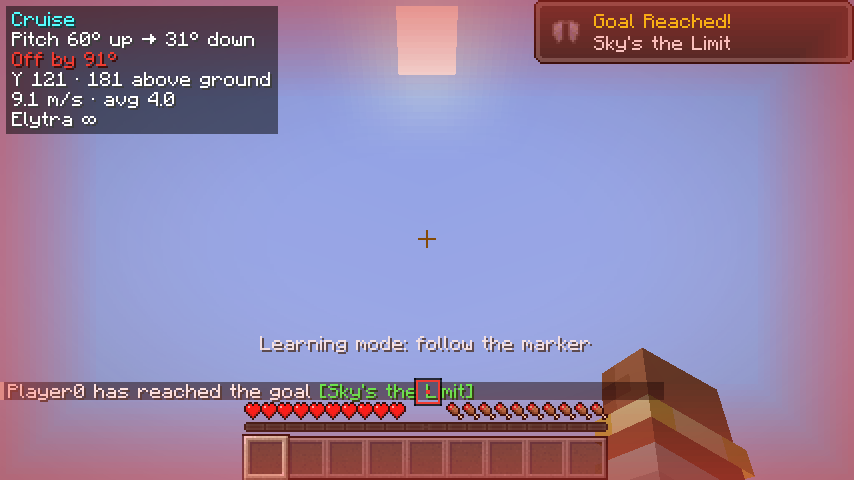
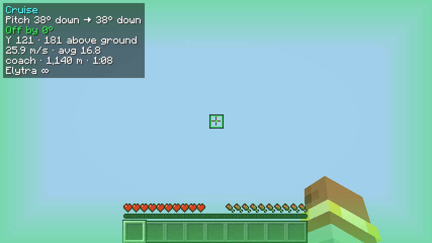

# Glide Pilot

Client-side elytra autopilot for Fabric, Minecraft Java 26.3.

Flies to coordinates or saved waypoints without spending rockets, holds a height above the terrain instead of a fixed Y, waits when chunks are not loaded, picks a safe block near the destination and lands on it without fall damage.

## Requirements

- Minecraft Java 26.3
- Fabric Loader 0.19.3+
- Fabric API
- Java 25
- Mod Menu (optional, for the settings button)

Client only. Nothing is needed on the server.

## Use

Start gliding, then press `R` to hold the current heading at cruise, or give a destination:

| Command | Effect |
|---|---|
| `/glide to <x> <z>` | Fly to coordinates and land |
| `/glide to <waypoint>` | Fly to a saved waypoint |
| `/glide via <x> <z>` or `<waypoint>` | Add a stop to the end of the route |
| `/glide takeoff [<x> <z>]` | Take off from the ground with rockets, then fly |
| `/glide land` | Land at the nearest safe block below |
| `/glide stop` | Hand control back |
| `/glide route [clear]` | Show the route, or drop the later stops |
| `/glide wp set <name> [<x> <z>]` | Save a waypoint (current position if no coordinates) |
| `/glide wp remove <name>` | Delete a waypoint |
| `/glide wp list` | List waypoints |
| `/glide style low\|medium\|high` | Cruise style |
| `/glide config` | Open settings |

Keys (Controls > Glide Pilot): autopilot on/off (`R`), land now, take off, settings. The last three start unbound.

Moving the mouse turns the autopilot off when "Mouse takes over" is on.

## How it flies

Cruise is a repeating pitch cycle: dive to build speed, pull up to convert it back into height. The cycles were found with a port of the 26.3 `LivingEntity.updateFallFlyingMovement` code and an optimizer that maximises average horizontal speed for a given height swing, so each style trades swing for speed.

| Style | Height swing | Simulated average |
|---|---|---|
| Low swing | 40 blocks | 23.3 m/s |
| Medium swing | 80 blocks | 29.8 m/s |
| Fastest | 132 blocks | 32.6 m/s |

The cycle is phase-locked to the player's actual speed and pitch, so engaging mid-flight does not waste height.

Height is measured from the terrain ahead. The mod reads the heightmap along a corridor in front of the flight path, keeps the bottom of each swing above the terrain clearance, and climbs early for mountains. If the ground ahead rises faster than a glide can climb, it aborts the dive and pulls up. Cruise stays between "Lowest cruise Y" and `maxCruiseY`.

If chunks along the path are not loaded, the autopilot circles in place until they arrive.

## Learning mode

Turn on "Learning mode" in settings (Mod Menu or `/glide config`). The autopilot then flies nothing itself. It works out the angle it would use and shows it, and you fly.

- Starting a glide begins coaching automatically. `/glide to`, `via`, `land` and `R` work as usual, they just coach instead of steer.
- A square marker shows where to aim. When the target is off screen it sits at the nearest edge.
- The panel shows your pitch, the target pitch, how far off you are, and a turn direction when the heading is more than 8° out.
- The screen is tinted green within 4°, yellow at 10°, red from 20°, blended in between. Heading error counts a third as much as pitch.
- The target is shown 3 ticks early and graded against a short window, so normal reaction time does not count as an error.
- Rockets are never fired for you. The panel says when to jump, open the elytra, look up, use a rocket or pull up.
- Elytra swapping still happens automatically.

"Tint" sets the strength, 0 to 60%.

| Off target | On target |
|---|---|
|  |  |

## Landing

Near the destination the mod searches rings outward from the target for a block that is:

- solid, not leaves, not a hazard (lava, fire, magma, campfire, cactus, berry bush, powder snow and similar)
- flat across 3x3
- open to the sky above

Water at least 2 deep also counts. It then spirals down over the site, slows to a shallow glide at pitch -12 (about 1.4 blocks of drop per second) and touches down. In testing this lands with 0 damage.

## Equipment

- Any item with the glider component counts, not just the vanilla elytra.
- The HUD shows flight time left on the elytra, adjusted for Unbreaking, and turns red when that is shorter than the ETA.
- With "Swap spare elytra" on, a spare elytra in the inventory is put on mid-air when the worn one drops to the low-durability threshold. With no spare, the autopilot lands.
- Rocket assist uses only rockets with no firework stars, so it never fires a rocket that hurts you. "Explosive rockets" in settings allows them.

## Settings

Stored in `config/glidepilot.json`. Waypoints are stored in `config/glidepilot-waypoints.json`, separated per server or singleplayer world and per dimension.

| Setting | Default |
|---|---|
| Cruise | Medium swing |
| Terrain clearance | 40 |
| Lowest cruise Y | 100 |
| Turn rate | 4°/tick |
| Land at destination | on |
| Landing search | 24 blocks |
| Mouse takes over | on |
| Wait for chunks | on |
| Swap spare elytra | on |
| Rocket assist | on |
| Explosive rockets | off |
| Takeoff height | 60 |
| Flight HUD | on |
| Learning mode | off |
| Tint | 25% |

File-only: `maxCruiseY` (600), `lowDurability` (10, uses left before swapping or landing), `hudX` and `hudY` (6, 6).

## Compared with Elytra Autopilot

[Elytra Autopilot](https://modrinth.com/mod/elytra-autopilot) cruises between fixed absolute heights (Y 180 to 360, or 320 to 480 in strategy mode) and has no terrain awareness. Glide Pilot adds:

- terrain-relative cruising with lookahead and a pull-up guard
- shorter-swing cruise styles for lower ceilings or lower altitudes
- waiting for unloaded chunks
- a landing-site search and a no-damage touchdown
- multi-stop routes and per-world, per-dimension waypoints
- elytra durability planning and mid-air spare swap
- refusing explosive rockets
- support for any glider item
- a learning mode that coaches you to fly the same profiles by hand
- built-in settings screen with no YACL or Cloth Config dependency

No code or flight data from Elytra Autopilot is included. The flight profiles were generated independently from the game's movement code.

## Notes

Some servers' anti-cheat may flag automated flight. Check the server's rules before using it in multiplayer.

The autopilot needs open sky, so it refuses to engage under the Nether roof.

## Build

```
./gradlew build
```

The jar is written to `build/libs/`. `./gradlew runClientGameTest` runs the in-game flight tests.

## License

CC0-1.0
